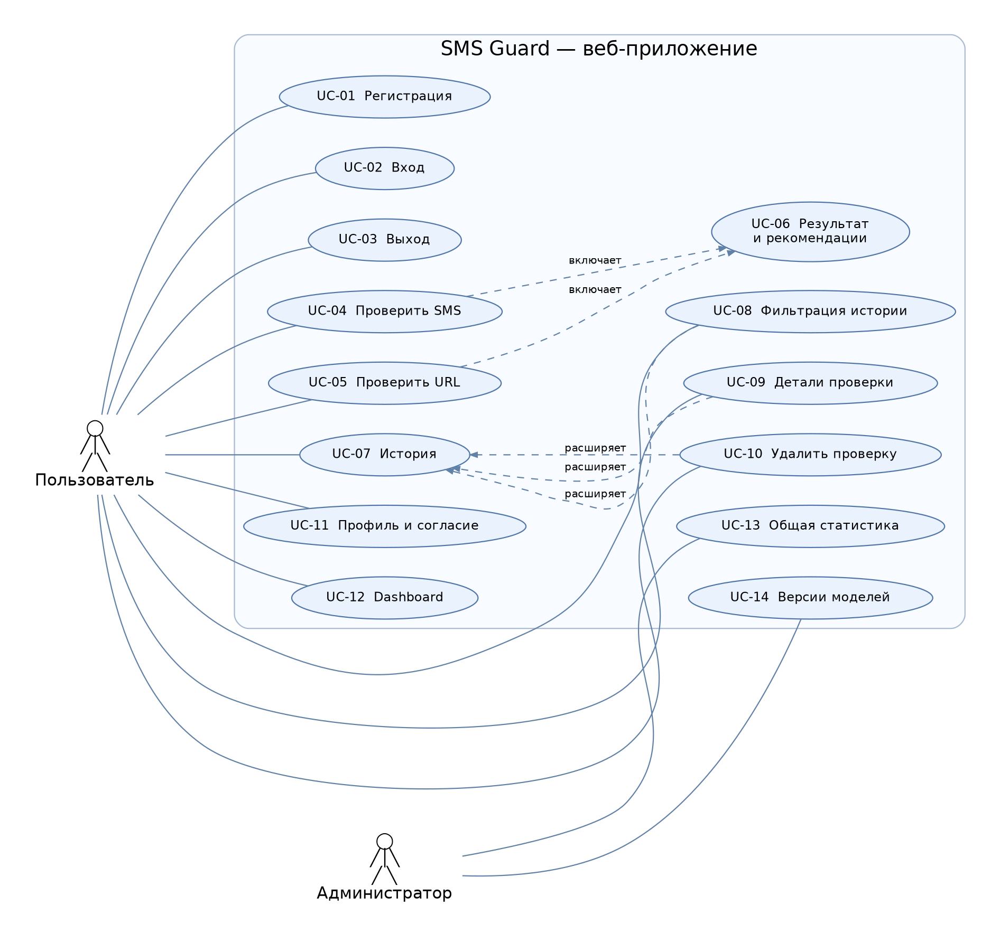

# Задание 1. Анализ предметной области и проектирование SMS Guard

**Проект:** «Интеллектуальная система обнаружения мошеннических SMS-сообщений и подозрительных ссылок на основе методов искусственного интеллекта и машинного обучения»  
**Рабочее название:** SMS Guard  
**Тип работы:** учебный проект бакалавриата  
**Основание:** техническое задание «Интеллектуальная система обнаружения мошеннических SMS и подозрительных ссылок», разделы 1–3, 4, 5 (задание 1).  
**Дата составления:** 31.10.2026

## 1. Введение: проблема и актуальность

**Смишинг (smishing)** — разновидность фишинга, при которой злоумышленники используют SMS, чтобы убедить адресата совершить небезопасное действие: раскрыть код подтверждения, передать данные карты, перевести деньги или перейти по ссылке на поддельную страницу. В отличие от обычного информационного сообщения, мошенническое SMS часто сочетает правдоподобную легенду и психологическое давление.

Пользователю бывает трудно оценить достоверность отправителя и структуру ссылки, особенно когда сообщение использует название известного банка, службы доставки или государственного учреждения. Проверка только текста не выявляет все угрозы, а проверка только URL не учитывает контекст обращения. Поэтому в проекте предложен **совместный анализ SMS и найденных в нём URL**.

Система предназначена для самостоятельной проверки сообщений и ссылок. Она должна выдавать категорию, числовой риск **Risk Score (0–100)**, объяснение причин и практическую рекомендацию. Оценка вероятностная: низкий риск **не гарантирует**, что объект безопасен. По ТЗ ссылки при структурном анализе не открываются, страницы не загружаются и редиректы не выполняются.

**Цель:** спроектировать доступное веб-приложение для обнаружения признаков SMS-мошенничества и опасных URL с помощью двух моделей машинного обучения и набора объяснимых правил.

**Задачи этапа:** классифицировать угрозы; рассмотреть существующие защитные решения; определить пользователей и сценарии работы; построить диаграмму вариантов использования; описать функциональные и нефункциональные требования с приоритетами.

## 2. Категории угроз и искусственные примеры SMS

Примеры ниже полностью **искусственные** и приведены только для распознавания признаков социальной инженерии. В них нет настоящих банковских реквизитов, телефонов и рабочих вредоносных адресов; доменные зоны `.example` / `.test` зарезервированы для демонстрации.

| № | Категория угрозы | Искусственный пример SMS | Признаки социальной инженерии |
|---|---|---|---|
| 1 | Поддельный банк | «Служба банка: обнаружена необычная операция. Проверьте уведомление в личном кабинете по адресу `https://security-check.example`». | **Авторитет:** представление сотрудником банка; **страх:** намёк на чужую операцию. |
| 2 | «Блокировка карты» | «Ваша карта заблокирована! Срочно подтвердите данные через `http://card-verify.test`». | **Срочность**, **страх** потерять доступ к карте, **авторитет** банка. |
| 3 | Выигрыш / приз | «Поздравляем, вам назначен приз. Для подтверждения выигрыша перейдите на `http://prize-info.example` сегодня». | **Выгода**, **срочность** (ограниченное время). |
| 4 | Служба доставки | «Доставка задержана: требуется подтвердить адрес и оплату сбора в кабинете `http://parcel-status.test`». | **Авторитет** службы доставки, **страх** потерять посылку, **деньги**. |
| 5 | «Родственник в беде» | «Это я, срочно нужна помощь с оплатой. Никому пока не рассказывай, скоро всё объясню». | **Страх**, **срочность**, **секретность**, просьба о переводе. |
| 6 | Запрос кода из SMS | «Служба поддержки: для отмены операции сообщите код подтверждения из последнего SMS». | **Авторитет**, **страх**, запрос конфиденциального кода. |
| 7 | Поддельные госуслуги / штрафы | «Уведомление: обнаружен неоплаченный штраф. Уточните сведения на `http://fine-check.example` до конца дня». | **Авторитет** государственного органа, **страх** санкций, **срочность**. |
| 8 | Инвестиционное мошенничество | «Инвестиционный консультант: предложение с гарантированным доходом действует только сегодня. Подайте заявку на `http://profit-offer.test`». | **Выгода**, **авторитет**, **срочность** и обещание невозможной гарантии. |

Общие наблюдения: (1) один текст может содержать несколько психологических приёмов; (2) сама по себе ссылка не доказывает мошенничество; (3) язык и формулировки могут различаться; (4) слова «срочно», «код», «карта», «приз» полезны как сигналы, но нуждаются в контексте. В частности, **безопасное предупреждение «Никому не сообщайте код» нельзя автоматически считать запросом кода**.

По ТЗ базовый словарь признаков должен включать не менее шести групп: `URGENCY`, `MONEY_TRANSFER`, `BANK_CARD`, `ACCOUNT_BLOCK`, `PRIZE`, `CODE_REQUEST`. Дополнительно уместны `AUTHORITY` и `SECRECY`. Словарь правил дополняет, но не заменяет ML-классификатор.

## 3. Сравнение существующих решений

Для сравнения рассмотрены три решения, прямо указанные в ТЗ как возможные аналоги. Возможности описаны по официальной документации; ограничения отражают **разницу с целями учебного проекта**, а не утверждение о неэффективности продуктов.

| Решение | Назначение | Сильные стороны | Ограничения для задачи SMS Guard |
|---|---|---|---|
| **Google Messages: защита от спама и мошенничества** | Выявление подозрительных сообщений непосредственно в приложении сообщений, предупреждения и блокировка. | Автоматическая проверка; машинное обучение; возможность сообщить о спаме. | Привязано к поддерживаемому приложению/устройству. Не является отдельным учебным веб-инструментом с собственными воспроизводимыми моделями, Risk Score и историей анализов. |
| **Google Safe Browsing** | Проверка URL по перечням известных небезопасных веб-ресурсов, включая фишинг. | Специализированная репутационная информация; возможность интеграции через API. | Ориентирован на URL, а не содержание SMS и психологические признаки. Применяются ограничения API; отсутствие срабатывания не означает гарантию безопасности. |
| **VirusTotal** | Получение анализа URL, доменов и других объектов с опорой на многочисленные средства обнаружения. | Несколько источников сигналов; подробные отчёты по URL. | Внешний сервис, не заменяет локальную модель SMS; отправка URL может передавать их сервису/партнёрам, поэтому конфиденциальные URL загружать нельзя. |

**Источники по аналогам:**
1. Google Messages, «How Google protects your privacy with spam and scam protection»: https://support.google.com/messages/answer/9327903?hl=en
2. Google Safe Browsing, обзор API v5: https://developers.google.com/safe-browsing/reference
3. VirusTotal, «How it works»: https://docs.virustotal.com/docs/how-it-works
4. VirusTotal, предупреждение о конфиденциальности URL: https://docs.virustotal.com/reference/scan-url

**Вывод сравнения:** SMS Guard проектируется как независимое обучающее веб-приложение: пользователь самостоятельно вводит текст/URL; система показывает два модельных результата, причины и интегральный риск. Внешняя проверка репутации URL допускается лишь как необязательное дополнение, а не замена собственной модели. Не планируется утверждать, что SMS Guard превосходит перечисленные коммерческие решения по точности: для этого понадобилось бы отдельное корректное сравнительное исследование на общих данных.

## 4. Целевая аудитория и роли

**Целевая аудитория:** пользователи мобильной связи и интернета, получающие подозрительные SMS, в том числе люди без специальных знаний в информационной безопасности. Вторичная аудитория — преподаватель/исследователь, проверяющий воспроизводимость ML-моделей и корректность реализации.

**Роль «Пользователь».** Регистрируется и входит в систему; проверяет SMS/URL; видит уровень риска, причины и рекомендацию; просматривает и удаляет **только собственные** результаты; управляет настройкой хранения исходного текста. Проверки и персональная история недоступны без авторизации.

**Роль «Администратор».** Имеет функции пользователя и дополнительно просматривает **обезличенную агрегированную** статистику системы и сведения об активных версиях моделей. Чужие тексты SMS администратору не показываются в агрегированных отчётах.

**Типовой пользовательский сценарий:** вход → ввод SMS → валидация → определение языка и выделение ссылок → анализ текста и URL разными моделями → расчёт риска → объяснение и рекомендация → сохранение проверки → обновление статистики. Отдельный сценарий аналогично работает для URL без SMS.

## 5. Диаграмма вариантов использования (Use Case)

В диаграмме представлены две обязательные роли и **14 прецедентов**. Исходник диаграммы — `docs/diagrams/use_case_sms_guard.puml`; изображение — `docs/figures/use_case_sms_guard.png`.

| Код | Прецедент | Роль | Краткий результат |
|---|---|---|---|
| UC-01 | Регистрация | Пользователь | Создана учётная запись с проверкой полей. |
| UC-02 | Вход | Пользователь | Создана защищённая сессия. |
| UC-03 | Выход | Пользователь | Сессия завершена. |
| UC-04 | Проверить SMS | Пользователь | Оценён текст; при наличии ссылок они проверены отдельно. |
| UC-05 | Проверить URL | Пользователь | Получены риск и признаки ссылки без открытия страницы. |
| UC-06 | Просмотреть объяснение и рекомендации | Пользователь | Отображены категория, Risk Score и причины. |
| UC-07 | Открыть историю проверок | Пользователь | Показаны только собственные записи. |
| UC-08 | Отфильтровать историю | Пользователь | Применены фильтры и пагинация. |
| UC-09 | Посмотреть детали проверки | Пользователь | Открыта своя сохранённая запись. |
| UC-10 | Удалить проверку | Пользователь | Удалена только своя запись. |
| UC-11 | Настроить профиль и согласие | Пользователь | Настроено хранение текста SMS. |
| UC-12 | Открыть Dashboard | Пользователь | Получены личные счётчики и графики. |
| UC-13 | Просмотреть агрегированную статистику | Администратор | Показаны сводные данные без чужих SMS. |
| UC-14 | Просмотреть версии моделей | Администратор | Показаны версии и доступные метрики. |

## 6. Требования и приоритеты MoSCoW

**Must (M):** обязательно для основной работоспособности, безопасности и соответствия ТЗ. **Should (S):** желательно для целостного решения, но не блокирует базовую демонстрацию. **Could (C):** дополнительная функция. Коды `ФТ-1`–`ФТ-3` и `НФТ-1`–`НФТ-15` взяты из ТЗ; коды `ФТ-4`–`ФТ-7` систематизируют требования разделов 2.4–2.7, в которых отдельные номера не приведены. Приоритеты — **проектное решение**, а не оценка, указанная преподавателем.

### 6.1. Функциональные требования

**Авторизация и доступ (раздел 2.1 ТЗ)**

| Код | Краткое требование | Приоритет |
|---|---|:---:|
| ФТ-1.1 | Регистрация: логин 3–30, e-mail, пароль ≥ 8 (буквы и цифры). | M |
| ФТ-1.2 | Уникальность логина/e-mail, понятная ошибка при повторе. | M |
| ФТ-1.3 | Вход; после 5 неудач — пауза ≥ 60 с. | M |
| ФТ-1.4 | Пароли только в виде хеша с солью. | M |
| ФТ-1.5 | Выход уничтожает пользовательскую сессию. | M |
| ФТ-1.6 | Проверка, история, Dashboard, профиль доступны после входа. | M |
| ФТ-1.7 | Доступ только к своим проверкам, чужая запись → 403/404. | M |
| ФТ-1.8 | HttpOnly/SameSite=Lax/Secure при HTTPS; CSRF на POST. | M |
| ФТ-1.9 | Администратор: агрегированная статистика без чужих SMS. | M |

**Анализ SMS (раздел 2.2 ТЗ)**

| Код | Краткое требование | Приоритет |
|---|---|:---:|
| ФТ-2.1 | Ввод от 1 до 1000 символов, пустое/пробелы отклоняются. | M |
| ФТ-2.2 | Определение языка `ru`, `kk`, `en`, `other`. | M |
| ФТ-2.3 | Нормализация и токены URL/телефон/число/сумма. | M |
| ФТ-2.4 | Одинаковый сохранённый TF-IDF pipeline для обучения и проверки. | M |
| ФТ-2.5 | Правила: не менее шести групп мошеннических выражений. | M |
| ФТ-2.6 | SMS-модель выдаёт вероятность `P_sms` от 0 до 1. | M |
| ФТ-2.7 | Автоматическая проверка до трёх URL внутри SMS. | M |
| ФТ-2.8 | Предупреждение о ненадёжности ML на неизвестном языке. | M |

**Проверка URL (раздел 2.3 ТЗ)**

| Код | Краткое требование | Приоритет |
|---|---|:---:|
| ФТ-3.1 | Формат `http`/`https` или без схемы, длина ≤ 2048. | M |
| ФТ-3.2 | Не менее 20 числовых признаков из строки URL. | M |
| ФТ-3.3 | Определение IPv4/IPv6 вместо домена. | M |
| ФТ-3.4 | Подсчёт поддоменов, точек, дефисов, цифр и спецсимволов. | M |
| ФТ-3.5 | Признаки HTTPS, порта, `@`, двойного `//` в пути. | M |
| ФТ-3.6 | Список не менее 15 сервисов сокращения URL. | M |
| ФТ-3.7 | Поиск подозрительных слов в адресе. | M |
| ФТ-3.8 | Punycode, смешение алфавитов, сходство с брендом. | M |
| ФТ-3.9 | URL-модель выдаёт `P_url`, SAFE/SUSPICIOUS/DANGEROUS. | M |
| ФТ-3.10 | URL выводится неактивным текстом, домен выделяется. | M |
| ФТ-3.11 | Дополнительная проверка репутации внешним API с таймаутом. | C |

**Интеллектуальный модуль, риск, Dashboard, история (разделы 2.4–2.7 ТЗ)**

| Код | Краткое требование | Приоритет |
|---|---|:---:|
| ФТ-4.1 | SMS: сравнение ≥ 3 моделей с TF-IDF, выбор итоговой. | M |
| ФТ-4.2 | URL: сравнение ≥ 2 моделей на структурных признаках. | M |
| ФТ-4.3 | Сохранение моделей и метаданных (версия, дата, метрики, порог). | M |
| ФТ-4.4 | Загрузка моделей один раз при старте процесса. | M |
| ФТ-5.1 | Risk Score 0–100 из `P_sms`, максимума `P_url` и правил. | M |
| ФТ-5.2 | Низкий/средний/высокий уровень, соответствующая категория. | M |
| ФТ-5.3 | Веса и пороги в `risk_config.yaml`, калибровка на валидации. | M |
| ФТ-5.4 | Не менее одной причины, рекомендация и предупреждение. | M |
| ФТ-6.1 | Dashboard: количества SMS/URL, категории, уровни риска. | M |
| ФТ-6.2 | Диаграммы распределения и динамики проверок за 30 дней. | M |
| ФТ-6.3 | Топ-5 правил и таблица 5–10 последних проверок. | M |
| ФТ-6.4 | Переключение периода 7/30/90 дней. | S |
| ФТ-7.1 | История: дата, тип, категория, риск, вероятности, версии. | M |
| ФТ-7.2 | Пагинация по 20; фильтрация и новые записи сверху. | M |
| ФТ-7.3 | Просмотр деталей и удаление только собственных записей. | M |
| ФТ-7.4 | Согласие на хранение текста выключено по умолчанию; маска. | M |
| ФТ-7.5 | Экспорт своей истории в CSV. | C |

### 6.2. Нефункциональные требования (раздел 3.1 ТЗ)

| Код | Краткое требование | Приоритет |
|---|---|:---:|
| НФТ-1 | Анализ SMS с ≤ 3 URL не дольше 500 мс без внешних API. | M |
| НФТ-2 | Dashboard при 1000 записях загружается ≤ 2 с. | M |
| НФТ-3 | Двойное нажатие не создаёт дубликаты записи. | M |
| НФТ-4 | Только ORM/параметризованные SQL-запросы. | M |
| НФТ-5 | Безопасный вывод пользовательского текста (защита от XSS). | M |
| НФТ-6 | До 30 проверок/мин на пользователя; превышение → 429. | M |
| НФТ-7 | Секреты в `.env`, `DEBUG=False` для демонстрации. | M |
| НФТ-8 | Если есть загрузка файлов: `.txt`/`.csv`, ≤ 1 МБ, проверка. | S |
| НФТ-9 | Исходные тексты SMS не записываются в логи. | M |
| НФТ-10 | Корректная адаптивность на 360/768/1366 px. | M |
| НФТ-11 | Ошибки ввода на русском языке рядом с полем. | M |
| НФТ-12 | Ошибочный ввод не вызывает HTTP 500. | M |
| НФТ-13 | `logs/app.log` с ротацией и полями события. | M |
| НФТ-14 | Отсутствие модели обрабатывается понятным сообщением. | M |
| НФТ-15 | Покрытие модульными тестами `ml/` и `risk/` ≥ 60%. | M |

**Технологические ограничения из ТЗ:** Python ≥ 3.11; Django 5.x + Django REST Framework (допускается FastAPI); scikit-learn, pandas, NumPy, NLP-инструменты; Bootstrap 5 и Chart.js/Plotly.js; БД SQLite при разработке и PostgreSQL 15+ для демонстрации; pytest; Git. Эти решения описывают платформу реализации, а не отдельные пользовательские прецеденты.

## 7. Границы системы и ограничения

1. **Две отдельные модели:** SMS-классификатор на тексте и URL-классификатор на структурных признаках; результаты сводятся в отдельном модуле риска.
2. **Без перехода по ссылкам:** URL разбирается как строка; сетевой запрос для загрузки страницы не выполняется. API проверки репутации — необязательный внешний сервис.
3. **Многоязычность:** основной набор UCI SMS Spam Collection англоязычный. До независимой проверки русских и казахских сообщений ML-оценка этих языков маркируется как менее надёжная. В ТЗ предусмотрен собственный искусственный набор: ≥ 100 SMS на русском, ≥ 50 на казахском; для заявления поддержки каждого языка требуется Recall мошеннического класса ≥ 0,80.
4. **Данные и этика:** нельзя использовать реальные SMS третьих лиц без согласия. Обучающие данные необходимо очищать от точных дубликатов до разбиения; TF-IDF обучать только на train; URL разделять по группам регистрируемых доменов для исключения утечки данных.
5. **Безопасность и приватность:** ограничения авторизации и доступа к чужим данным, CSRF, экранирование вывода, хеширование паролей. Без согласия исходные тексты SMS не хранятся; чувствительные данные в истории маскируются.
6. **Объяснимость:** ответ включает не только категорию, но и причины, уровень риска, рекомендацию и заметное предупреждение о вероятностном характере вывода.

## 8. Ожидаемый результат задания 1 и критерии приёмки

По завершении этапа подготовлены: аналитический документ `docs/01_domain_analysis.md`, исходник и иллюстрация Use Case, таблица требований с MoSCoW. Проверяется: **8 категорий угроз** (нужно ≥ 6), **3 аналога** (нужно ≥ 3), **14 прецедентов** (нужно ≥ 8), **две роли** и индивидуальные коды с приоритетами у всех перечисленных ФТ/НФТ.

**Что пока не сделано:** Django-приложение, датасеты, ML-модели, функциональные тесты и интерфейс. Это результаты **последующих** заданий 2–18, и их нельзя выдавать за выполненные по результатам одной аналитической работы.

**Коммит по формату ТЗ:** `task-01: domain analysis and use cases`.

## 9. Использованные источники

[1] Техническое задание «Интеллектуальная система обнаружения мошеннических SMS и подозрительных ссылок», разделы 1–5, 8–9 (предоставленный преподавателем PDF).  
[2] Google, *How Google protects your privacy with spam and scam protection*, https://support.google.com/messages/answer/9327903?hl=en (дата обращения: 31.10.2026).  
[3] Google, *Safe Browsing APIs Overview*, https://developers.google.com/safe-browsing/reference (дата обращения: 31.10.2026).  
[4] VirusTotal, *How it works*, https://docs.virustotal.com/docs/how-it-works (дата обращения: 31.10.2026).  
[5] VirusTotal, *Scan URL*, https://docs.virustotal.com/reference/scan-url (дата обращения: 31.10.2026).
